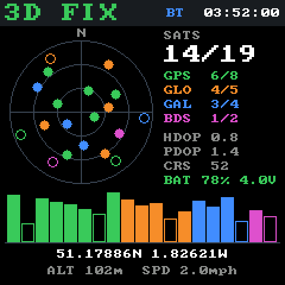
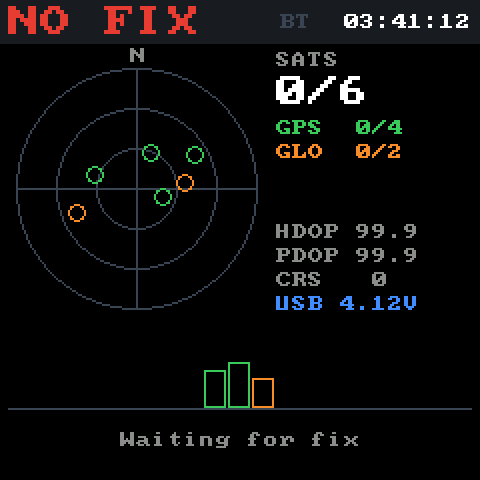

# PicoNMEA

Pico 2 W and Pico LiPo 2 XL W firmware that turns an I2C MTK GPS module (eg: PA1010D) into a Bluetooth, USB and serial GPS receiver.

NMEA sentences from the GPS are sent to every output. Anything received on an output (eg: `$PMTK` commands) is passed to the GPS.

Hook it to a desktop computer and you can even run simulated test GPS tracks.

## Parts

- [PA1010D GPS Breakout](https://shop.pimoroni.com/products/pa1010d-gps-breakout?variant=32257258881107) or [Adafruit Mini GPS PA1010D](https://shop.pimoroni.com/products/adafruit-mini-gps-pa1010d-uart-and-i2c-stemma-qt?variant=31116407308371)
- One of:
  - [Raspberry Pi Pico 2 W](https://www.raspberrypi.com/products/raspberry-pi-pico-2/) and a [JST-SH to DuPont socket cable](https://shop.pimoroni.com/products/jst-sh-cable-qwiic-stemma-qt-compatible?variant=40409136332883)
  - [Pimoroni Pico LiPo 2 XL W](https://shop.pimoroni.com/products/pimoroni-pico-lipo-2-xl-w?variant=55447911006587) and a JST-SH cable, for battery power
- Optional: a [1.54" SPI Colour Square LCD (240x240) Breakout](https://shop.pimoroni.com/products/1-54-spi-colour-square-lcd-240x240-breakout?variant=39351811702867). On the Pico LiPo 2 XL W, connect it with an [8-pin JST-SH cable (SP/CE)](https://shop.pimoroni.com/products/8-pin-jst-sh-cable-sp-ce?variant=41908359757907). On a Pico 2 W, wire it to the display pins below.

## Pins

| Function | Pico 2 W | Pico LiPo 2 XL W |
|----------|----------|------------------|
| GPS SDA (I2C0, 0x10) | GP0 | GP4 (Qw/ST) |
| GPS SCL (I2C0) | GP1 | GP5 (Qw/ST) |
| UART1 TX | GP4 | GP8 |
| UART1 RX | GP5 | GP9 |
| Display SCK (SPI) | GP10 (SPI1) | GP34 (SP/CE, SPI0) |
| Display MOSI | GP11 | GP35 |
| Display DC | GP12 | GP32 |
| Display CS | GP13 | GP33 |
| Display backlight | GP14 | GP36 |

## Outputs

- **Bluetooth Classic SPP**: appears as `PicoGPS xx:xx:xx:xx:xx:xx`, PIN `0000`. Tested with Windows Mobile 5 (Dell Axim X51v) and macOS.
- **USB**: CDC serial port.
- **UART**: 9600 8N1 at 3.3V logic. Use a level shifter (eg: MAX3232) for RS232.

The onboard LED is lit while a Bluetooth client is connected.

<p>
  
  
</p>

With a display fitted, it shows the fix type, UTC time, a sky plot of satellites (by constellation, filled when used in the fix), per-satellite signal strength, DOP, position, altitude and speed. It follows simulated positions while simulating.

The Pico LiPo 2 XL W also reports battery voltage and an estimated charge level (from a typical LiPo discharge curve), on the display and over USB. The estimate reads high while charging.

## Simulator

`web/simulator.html` drives the device from a browser over WebSerial (Chrome or Edge), replacing the GPS with simulated positions on the Bluetooth and UART outputs. Click the map to set a fixed position, or draw a path and play it back at a chosen speed. Imported GPX or OziExplorer `.plt` tracks are shown coloured by speed, with distance, moving time, average and maximum speed, and can be played back too.

Serve it from localhost, as the map tiles need a referrer:

```
python3 -m http.server -d web 8000
```

Then open http://localhost:8000/simulator.html.

Simulation is controlled with `$PPNM` sentences over USB serial:

| Command | Effect |
|---------|--------|
| `$PPNM,SIM,1` | Stop real GPS output and relay NMEA lines received over USB to Bluetooth and UART |
| `$PPNM,SIM,0` | Return to real GPS |
| `$PPNM,STATUS` | Report `$PPNM,STATUS,<simulating>,<bluetooth client>` |
| `$PPNM,BATTERY` | Report `$PPNM,BATTERY,<millivolts>,<percent>,<usb power>` (empty fields on boards without battery sensing) |

Status is also sent when a Bluetooth client connects or disconnects. Simulation ends when the USB serial port is closed.

## Building

Requires pico-sdk 2.3.1 or later.

```
export PICO_SDK_PATH=/path/to/pico-sdk
cmake -S . -B build -G Ninja -DPICO_BOARD=pico2_w
ninja -C build
```

Use `-DPICO_BOARD=pimoroni_pico_lipo2xl_w` for the Pico LiPo 2 XL W.

Pins and peripherals for each board are in `src/boards/<PICO_BOARD>.h`. To support another board, add a header there.

`tools/render_mocks.py` regenerates the display screenshots above on a desktop computer, by compiling the display code against staged NMEA (`uv run tools/render_mocks.py`).

Add `-DPICONMEA_HCI_DUMP=ON` to dump Bluetooth HCI traffic and status messages to USB serial instead of NMEA. This build waits for USB serial to be opened before starting.

## License

MIT, see [LICENSE](LICENSE). The 8x8 font in `src/font8x8.c` is from [font8x8](https://github.com/dhepper/font8x8) by Daniel Hepper, public domain.
